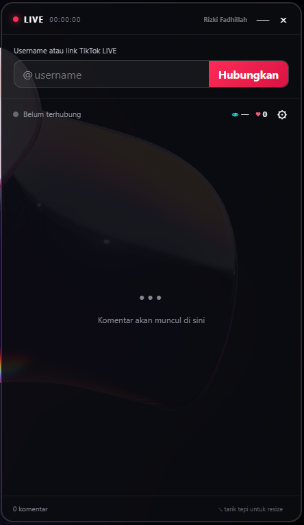

<div align="center">

# 🎬 Multi Live Chat Overlay

**Gabungkan chat TikTok LIVE, YouTube Live, dan Twitch dalam satu overlay transparan.**


Dibuat oleh **Rizki Fadhillah**

</div>

---

## Tentang aplikasi

Multi Live Chat Overlay membantu streamer membaca beberapa chat sekaligus tanpa berpindah jendela. Overlay dapat ditempatkan di atas game, OBS, browser, atau aplikasi lain dan ukurannya bisa disesuaikan.

Aplikasi dapat menghubungkan beberapa sumber TikTok, YouTube, dan Twitch secara bersamaan. Setiap pesan memiliki badge platform agar mudah dibedakan.

## ✨ Fitur

- 💬 Menggabungkan beberapa chat LIVE secara real-time
- 🎵 Mendukung TikTok LIVE
- ▶️ Mendukung YouTube Live tanpa API key
- 🟣 Mendukung Twitch Chat tanpa login
- 🔀 Mendukung banyak stream sekaligus
- 🏷️ Badge platform pada setiap pesan
- 📊 Statistik viewer dipisahkan untuk setiap stream/platform
- 📱 Android companion melalui Wi-Fi lokal dengan token akses
- 🐧 Paket Linux x64 portabel (`tar.gz`)
- 🎮 Prototipe Xbox Game Bar Widget untuk overlay yang dapat dipin di atas game
- 😄 Menampilkan emoji dan emote bergambar dari YouTube/TikTok
- 🖼️ Menampilkan YouTube Super Sticker
- 👁️ Menampilkan jumlah penonton aktif saat ini
- 🏆 Menampilkan top viewers dari snapshot TikTok
- ❤️ Menampilkan total like
- 🎁 Notifikasi gift dan jumlah combo
- 🔗 Notifikasi saat LIVE dibagikan
- ➕ Notifikasi saat seseorang mengikuti host
- 👋 Ticker user yang baru bergabung tanpa memenuhi daftar chat
- 📌 Mode selalu di atas aplikasi lain
- 🪟 Overlay transparan dengan opasitas yang bisa diatur
- 🖱️ Mode klik-tembus untuk penggunaan di atas game
- 📐 Ukuran jendela kecil, sedang, besar, dan resize manual
- 🔤 Ukuran teks dapat disesuaikan
- 🪶 Mode Lite tanpa Chromium dengan penggunaan RAM idle di bawah 100 MB

## 📸 Tampilan



## 🚀 Cara paling mudah

1. Buka folder `dist`.
2. Jalankan **Multi Live Chat Overlay 3.2.3.exe**.
3. Pilih TikTok, YouTube, atau Twitch.
4. Masukkan username, channel, video ID, channel ID, atau URL sesuai platform.
5. Klik **Tambah**. Ulangi langkah ini untuk menampilkan beberapa chat sekaligus.

EXE bersifat portable sehingga tidak membutuhkan proses instalasi.

## 🎮 Kontrol overlay

| Kontrol | Fungsi |
|---|---|
| Tarik title bar | Memindahkan overlay |
| Tarik tepi jendela | Mengubah ukuran secara manual |
| Preset Kecil / Sedang / Besar | Mengubah ukuran dengan cepat |
| Selalu di atas | Menjaga overlay di atas aplikasi lain |
| Klik tembus | Membuat klik diteruskan ke aplikasi di belakangnya |
| `Ctrl` + `Shift` + `X` | Mengaktifkan atau mematikan klik-tembus dari aplikasi mana pun |
| `Ctrl` + `Shift` + `O` | Memunculkan dan memperkuat always-on-top overlay |

> **Penting:** Jika overlay tidak bisa diklik karena mode klik-tembus aktif, tekan **Ctrl + Shift + X** untuk mengembalikannya.

## 🛠️ Menjalankan dari source code

### Persyaratan

- Windows 10 atau Windows 11
- [Node.js](https://nodejs.org/) versi 20 atau lebih baru
- npm

### Instalasi

```powershell
git clone https://github.com/rizkif-com/Tiktok-Live-Chat-Overlay.git
cd tiktok-live-overlay
npm install
npm start
```

Di Windows, kamu juga bisa menjalankan `Jalankan.cmd`. Script tersebut akan memasang dependensi secara otomatis jika folder `node_modules` belum tersedia.

### Mode Lite (RAM di bawah 100 MB)

Mode desktop penuh memakai Electron/Chromium sehingga beberapa proses bawaannya tetap memerlukan sekitar 300 MB RAM. Untuk komputer dengan RAM terbatas, jalankan konektor tanpa jendela Electron:

```powershell
npm run start:lite -- --tiktok username --youtube "https://youtube.com/live/VIDEO_ID" --twitch channel
```

Semua parameter bersifat opsional dan dapat digabung untuk beberapa platform. Setelah aktif, terminal menampilkan link companion yang dapat dibuka di browser Android atau dipakai oleh Xbox Game Bar Widget. Pengujian idle pada Windows menggunakan sekitar **76 MB RSS**; penggunaan aktual dapat bertambah sesuai jumlah koneksi, chat, dan gambar.

Contoh satu sumber:

```powershell
npm run start:lite -- --twitch rizkif
```

Di Windows, perintah yang sama juga dapat diteruskan melalui `Jalankan Lite.cmd`. Tekan `Ctrl+C` untuk menghentikan service.

## 📦 Membuat EXE portable

```powershell
npm install
npm run pack
```

Hasil build tersedia di:

```text
dist/Multi Live Chat Overlay 3.2.3.exe
```

### Linux x64

```powershell
npm run pack:linux
```

Ekstrak `dist/multi-live-chat-overlay-3.1.1.tar.gz`, lalu jalankan executable `multi-live-chat-overlay`.

### Android companion

APK siap pasang tersedia di `dist/Multi Live Chat Android 1.0.0.apk` dan source Android berada di folder `android-app`.

1. Pasang APK pada ponsel Android 7.0 atau lebih baru.
2. Jalankan aplikasi desktop atau mode Lite pada PC dan hubungkan sumber LIVE.
3. Buka **Pengaturan overlay**, lalu salin link **Android companion**.
4. Pastikan ponsel dan PC menggunakan jaringan Wi-Fi yang sama.
5. Buka aplikasi Android, tempel link, lalu tekan **Hubungkan**.

Tekan tombol ⚙ di pojok kanan atas aplikasi Android untuk mengganti link PC. Link disimpan pada perangkat dan otomatis dibuka ketika aplikasi dijalankan kembali.

Android companion menerima chat, statistik, emoji, dan sticker dari service desktop. Aplikasi desktop harus tetap berjalan karena library konektor TikTok/YouTube/Twitch berbasis Node.js tidak dapat berjalan langsung di APK Android.

### Xbox Game Bar Widget

Source widget tersedia di folder `gamebar-widget`. Build dan deploy melalui Visual Studio dengan workload **Universal Windows Platform development**, lalu tekan `Win + G`, pilih **Multi Live Chat**, tempel link companion, dan pin widget.

Widget Game Bar adalah solusi yang direkomendasikan untuk tampil di atas game fullscreen. Dukungan true exclusive fullscreen tetap bergantung pada izin overlay dari game dan anti-cheat yang digunakan.

## 📁 Struktur proyek

```text
tiktok-live-overlay/
├── src/
│   ├── main.js         # Window Electron dan koneksi TikTok LIVE
│   ├── preload.cjs     # Jembatan IPC yang aman
│   ├── renderer.js     # Logika antarmuka overlay
│   ├── index.html      # Struktur tampilan
│   ├── styles.css      # Tampilan utama
│   └── controls.css    # Pengaturan dan kontrol ukuran
├── android-app/        # Source aplikasi Android native
├── Jalankan.cmd        # Menjalankan aplikasi desktop di Windows
├── Jalankan Lite.cmd   # Menjalankan service hemat RAM
├── package.json
└── README.md
```

## ❓ Pemecahan masalah

### Komentar tidak muncul

- Pastikan username sudah benar.
- Pastikan akun sedang LIVE.
- LIVE harus dapat diakses secara publik.
- Tunggu beberapa detik setelah status berubah menjadi terhubung.
- Putuskan koneksi lalu hubungkan kembali jika jaringan sempat terputus.

### Jumlah penonton masih `—`

Angka penonton diperbarui ketika TikTok mengirim event statistik `ROOM_USER`. Snapshot pertama dapat membutuhkan beberapa detik setelah koneksi berhasil.

### Overlay tidak bisa diklik

Mode klik-tembus sedang aktif. Tekan `Ctrl + Shift + X` untuk mematikannya.

### Windows menampilkan peringatan keamanan

Build lokal mungkin belum memiliki sertifikat code-signing publik. Periksa source code dan build sendiri apabila kamu ingin memastikan isi aplikasinya.

## ⚠️ Catatan dan disclaimer

Proyek ini menggunakan [`tiktok-live-connector`](https://www.npmjs.com/package/tiktok-live-connector), sebuah library tidak resmi yang membaca event webcast TikTok LIVE publik.

Proyek ini:

- tidak berafiliasi, disponsori, atau didukung oleh TikTok maupun ByteDance;
- tidak meminta password TikTok;
- hanya ditujukan untuk membaca aktivitas LIVE yang dapat diakses publik;
- dapat berhenti bekerja apabila TikTok mengubah endpoint, format event, atau kebijakan aksesnya.

Gunakan aplikasi secara bertanggung jawab dan patuhi ketentuan platform yang berlaku.

## 🤝 Kontribusi

Kontribusi sangat terbuka. Kamu dapat:

1. Fork repository ini.
2. Buat branch fitur baru.
3. Commit perubahanmu.
4. Buka Pull Request dengan penjelasan yang jelas.

Untuk laporan bug, sertakan versi aplikasi, versi Windows, pesan error, dan langkah untuk mereproduksi masalah.

## 👤 Author

**Rizki Fadhillah**

Jika proyek ini membantu, jangan lupa beri ⭐ pada repository.

---

<div align="center">

Made with ❤️ for TikTok LIVE creators

</div>
